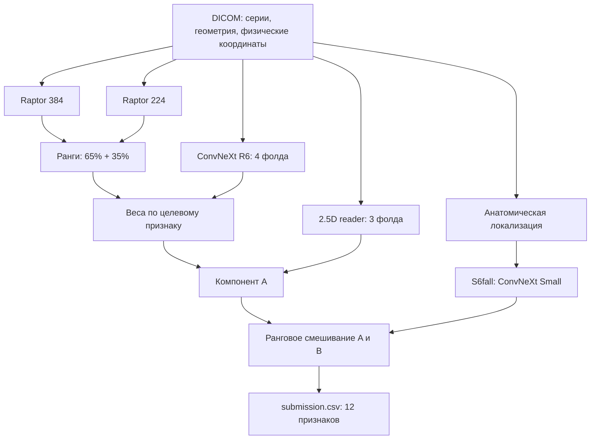

# RSNA Knee — Мисис и точка.

Классификация МРТ коленного сустава в соревновании **RSNA Knee Abnormality Detection**. Для каждого исследования система оценивает 12 патологических признаков, объединяя информацию из нескольких серий, плоскостей и соседних срезов.

Команда **«Мисис и точка.»** подготовила два финальных решения с **public AUC 0.958** и **private AUC 0.943**.

## Содержание

- [Задача и метрика](#задача-и-метрика)
- [Два финальных решения](#два-финальных-решения)
- [Архитектура](#архитектура)
- [Данные и обучение](#данные-и-обучение)
- [Валидация](#валидация)
- [Результаты и эксперименты](#результаты-и-эксперименты)
- [Запуск и воспроизведение](#запуск-и-воспроизведение)
- [Структура репозитория и стек](#структура-репозитория-и-стек)
- [Команда и вклад](#команда-и-вклад)
- [Выводы и дальнейшее применение](#выводы-и-дальнейшее-применение)
- [Источники и лицензия](#источники-и-лицензия)

## Задача и метрика

Одно исследование содержит несколько DICOM-серий с разным числом срезов, ориентацией, физическим разрешением и режимом подавления жира. Выход — строка `submission.csv`: `StudyInstanceUID` и 12 числовых оценок.

| Группа | Целевые признаки |
|---|---|
| Связки | ACL, MCL |
| Мениски | Medial Meniscus, Lateral Meniscus |
| Остеоартроз | Medial OA, Lateral OA, PF OA |
| Жидкость и воспаление | Effusion, Synovitis, Baker's |
| Повреждения кости | Contusion, Fracture |

Метрика соревнования — среднее ROC AUC по 12 признакам. Для неё важен порядок оценок исследований. Это позволяет объединять модели через процентильные ранги, даже если их вероятности откалиброваны по-разному. Финальная ранговая оценка не интерпретируется как калиброванная вероятность заболевания.

В обучающей части 4 407 исследований; полная структурированная разметка доступна для 58 из них. Для остальных используются метки, извлечённые из радиологических заключений. Код соревнования выполняется на скрытом тесте без интернета с ограничением времени 9 часов.

## Два финальных решения

| Решение | Финальное смешивание | Kaggle script version | Исходник |
|---|---|---|---|
| **w20** | `0.8 × rank(A) + 0.2 × rank(B)` | `359932515` | [submit_a_s6fall_w20.py](exps/exp-0001/submit_a_s6fall_w20.py) |
| **w30** | `0.7 × rank(A) + 0.3 × rank(B)` | `360050163` | [submit_a_s6fall_w30.py](exps/exp-0001/submit_a_s6fall_w30.py) |

`rank` вычисляется отдельно для каждого признака; равные значения получают средний ранг. После финального взвешивания повторного ранжирования нет. Если B не смог обработать исследование, его доля передаётся A; превышение допустимой доли ошибок останавливает запуск. [Реализация](src/blend_kernel.py)

## Архитектура



**Компонент A** последовательно выполняет Raptor 384, Raptor 224, R6 и дополнительный 2.5D reader. В Raptor-ветке доля 224-модели равна 0.35. При смешивании с R6 доля Raptor по умолчанию 0.5; исключения — Lateral OA 0.15, PF OA 0.65, Synovitis 0.85 и Baker's 0.30. Вклад дополнительного reader зависит от признака и составляет 0.003–0.035. [Параметры и порядок выполнения](src/public_fork/pipeline.py)

Reader кодирует окна из трёх соседних срезов, добавляет признаки позиции и типа серии, затем объединяет токены через Transformer и attention по целевым признакам. Используется шесть слотов: три плоскости × два режима подавления жира.

**Компонент B — S6fall** использует ConvNeXt Small, анатомические ориентиры, представления `v4`, трёхсрезовые окна с параметром `phys_mm=3.5`, размер 320 и crop 288. На инференсе задан `eval_stride=1`, вычисления выполняются в FP16. [Запуск B](src/public_fork_s6fall/pipeline.py)

Сначала выполняется B в отдельном процессе, затем освобождаются обе GPU и запускается A. Такой порядок сохраняет окружение B до установки пакетов R6: `timm 1.0.29 / pydicom 3.0.2` сменяются на `1.0.25 / 3.0.1`. Контролируются лимиты времени, наличие исследований и контрольные суммы входов.

## Данные и обучение

Подготовка данных разделена на несколько этапов.

1. **Чтение и индексация:** индекс архива и чтение нужных диапазонов без обязательной распаковки всего набора — [zip_range.py](src/zip_range.py), [index_archive.py](exps/exp-0002/index_archive.py).
2. **Геометрия и кэш:** декодирование DICOM, сортировка срезов, физические координаты, нормализация и запись кэша объёмов — [knee_volume.py](src/knee_volume.py), [stream_cache.py](src/stream_cache.py), [build_cache.py](exps/exp-0002/build_cache.py).
3. **Метки:** чтение мягких целей и извлечение структурированных признаков из заключений — [knee_labels.py](src/knee_labels.py), [report_labels/](src/report_labels/), [exp-0003](exps/exp-0003/).
4. **Фолды:** группировка по нормализованному тексту заключения, пять фолдов, исключение gold58 из обучения — [make_folds.py](exps/exp-0004/make_folds.py).
5. **Обучение и OOF:** AdamW, BCE с мягкими целями, EMA, сохранение checkpoints, предсказаний и метрик — [train25d.py](src/train25d.py).

В проекте сохранены два дополнительных обучающих эксперимента. Эти модели исследовались отдельно и **не входят в финальные w20/w30**.

| Параметр | exp-0004 | exp-0005 |
|---|---|---|
| Backbone | ConvNeXt Tiny, ImageNet-22k | EfficientNetV2-S, ImageNet-21k |
| Размер входа | 352 | 300 |
| Представление | Широкий охват серии | Центрированные области колена |
| Эпох | 14 | 10 |
| Batch size | 8 | 6 |
| LR backbone / head | `1e-4 / 5e-4` | `1e-4 / 5e-4` |
| Weight decay / EMA | `0.02 / 0.998` | `0.02 / 0.998` |
| Окон на слот: train / eval | 8 / 16 | 6 / 16 |
| Фолдов | 5 | 5 |
| Скрипт | [train.py](exps/exp-0004/train.py) | [train.py](exps/exp-0005/train.py) |

### Обучение S6fall и CoAtNet

В [sources/B/training/](sources/B/training/) сохранён полный доступный обучающий комплект: тренеры S6, построение мягких целей, таблицы целей, списки исследований и скрипты CoAtNet. Шесть программ среды S6, включая модель и загрузчик кэша, находятся в [sources/B/runtime/heliosli/](sources/B/runtime/heliosli/). Файлы проверяются по контрольным суммам.

| Параметр S6fall | Значение |
|---|---|
| Тренер | [train_s6f0_all.py](sources/B/training/s6/train_s6f0_all.py) |
| Backbone | ConvNeXt Small, начальные веса `convnext_small.fb_in22k_ft_in1k` |
| Агрегация | Пространственное внимание по признакам + MIL по окнам исследования |
| Обучающие исследования | 4 263, gold58 исключены |
| Цели | Мягкие `E_prior`, BCE с нормировкой весов по признакам |
| Представления | `v4`: общий вид и локальные области 100 мм, анатомические ориентиры |
| Размер / crop / срезов в окне | 320 / 288 / 3 |
| Train windows / physical step | 64 / 3.5 мм |
| Эпох / batch size / seed | 16 / 2 / 42 |
| AdamW: LR backbone / head / weight decay | `1e-4 / 1e-3 / 0.05` |
| Расписание | 5% linear warmup, затем cosine до нуля |
| Точность и память | BF16, gradient checkpointing, clipping градиента 5 |
| Усреднение весов | Без EMA/SWA; checkpoint последней, 16-й эпохи |

Полная конфигурация находится в [E_prior_s42_fall.run_config.json](sources/B/E_prior_s42_fall.run_config.json). Зафиксированный пул содержит 4 321 исследование: 4 263 обучающих и 58 gold. Ещё 86 исследований отсутствовали на машине запуска из-за освобождения дискового пространства; это не фильтрация качества снимков. Список участников обучения сохранён в `sources/B/training/s6/data/`.

Тренеры CoAtNet находятся в [coatnet/](sources/B/training/coatnet/), точные команды и настройки усреднения весов — в [RUNS.md](sources/B/training/coatnet/RUNS.md). Внешние обучающие изображения и checkpoints необходимо подготовить отдельно. `src/public_fork/vendored/compact/compact_train.py.txt` относится к R6; отдельная версия тренера S6 сохранена рядом с его обучающим комплектом.

### Локальная обработка DICOM

[local_preprocessing.py](src/local_preprocessing.py) строит общий для обучения и инференса кэш:

1. Читает `StudyInstanceUID/SeriesInstanceUID/*.dcm`, проверяет идентификаторы и геометрию.
2. Сортирует срезы по проекции `ImagePositionPatient` на нормаль `ImageOrientationPatient`, обрабатывает дубликаты, приводит плоскости к канонической ориентации и учитывает физический размер пикселя.
3. Применяет RescaleSlope/Intercept, MONOCHROME1 и процентильную нормализацию. Тонкие серии объединяет в непересекающиеся слои около 3.5 мм.
4. Готовит общий вид и локальные области 100 мм с сохранением пропорций и заполнением краёв нулями. При наличии `joint_lps` использует заданную точку в координатах пациента; иначе — центр foreground или поля изображения.
5. Сохраняет `px.u8.npy`, `meta.f32.npy`, `index.json` и диагностику. Кэш читается сохранённым `compact_train.Studies`, который формирует трёхсрезовые окна для модели.

## Валидация

В локальных экспериментах оцениваются OOF-предсказания на мягких метках и диагностическая оценка на gold58. Исследования с одинаковым нормализованным заключением принадлежат одному фолду. [Зафиксированное разбиение](exps/exp-0004/runs/20261017t111717-941-7125/folds.csv)

Gold58 — маленькая выборка, которую использовали при исследовании моделей и выборе настроек. Её оценка не считается независимой окончательной проверкой. OOF AUC по слабым меткам и оценка Kaggle измеряют качество относительно разных источников разметки и напрямую не взаимозаменяемы.

Проверки инференса включают:

- согласованность локального и Kaggle-препроцессинга;
- сравнение FP16, BF16 и FP32 на отложенных исследованиях;
- проверку состава исследований, диапазона и конечности предсказаний;
- контроль SHA-256 исходников и checkpoints;
- измерение времени на выборках значительно больше трёх демонстрационных исследований;
- воспроизведение финального рангового смешивания по сохранённым выходам компонентов.

Команда `python tools/verify_repository.py` проверяет локальные файлы и точно воспроизводит оба сохранённых смешивания. Она не запускает нейросети и не подтверждает результат на скрытом тесте заново.

## Результаты и эксперименты

| Вариант | Public AUC | Private AUC | Статус |
|---|---|---|---|
| A | 0.958 | — | Базовый ансамбль |
| S6fall отдельно | 0.950 | — | Дополнительный компонент |
| A + S6fall, 20% | **0.958** | **0.943** | Финальный w20 |
| A + S6fall, 30% | **0.958** | **0.943** | Финальный w30 |

Пробы с долями S6fall 10%, 40% и 50%, а также вариант с дополнительным mirror TTA для Raptor 224 сохранены в [exp-0001](exps/exp-0001/). Финальная пара использует 20% и 30%.

Дополнительный ConvNeXt reader получил слабую OOF macro AUC около 0.8826, EfficientNet reader — около 0.8785. Их смешивание с долей ConvNeXt 0.6 дало около 0.8863 на тех же слабых целях. Эти числа характеризуют локальный эксперимент и не являются private score финальных решений.

В открытых Kaggle-запусках скрипты w20/w30 выполнялись примерно 9.5 и 12.3 минуты на трёх исследованиях. Это время демонстрационного инференса; оно не является временем прохождения скрытого теста. Подробные длительности этапов сохранены в `results/*/a_s6fall_receipt.json`.

## Запуск и воспроизведение

### Проверка без GPU и датасетов

```bash
cd rsna-knee-misis
python3 tools/verify_repository.py
python3 -m unittest discover -s tests -p 'test_packaging.py' -v
```

Обе команды используют стандартную библиотеку Python. Для тестов синтетических DICOM достаточно лёгкого окружения:

```bash
python3.11 -m venv .venv
source .venv/bin/activate
python -m pip install -r requirements-preprocess.txt
python -m unittest discover -s tests -v
```

Проверяются физический порядок срезов, наклонная геометрия, координаты локальных областей, дубликаты, объединение тонких срезов, сохранение пропорций, ошибочные UID и чтение кэша сохранённым загрузчиком модели. Тест загрузчика исполняет его код с NumPy вместо обёртки Tensor; он не проверяет нейросеть и не требует PyTorch.

При установленном полном окружении запускается также CPU smoke-тест: небольшой backbone со случайными весами проходит общий путь S6 до `submission.csv`, затем тренер выполняет `--check-targets`. Проверка не обучает модель, не скачивает веса и не измеряет качество решения.

### Локальное окружение

```bash
python3.11 -m venv .venv
source .venv/bin/activate
python -m pip install -r requirements.txt
cp local_paths.example.json local_paths.json
```

В `local_paths.json` задайте абсолютный путь к кэшу. Ожидаемая раскладка:

```text
<cache>/
├── competitions/rsna-knee-abnormality-detection/
│   ├── train.csv
│   ├── train_series.csv
│   └── ...
└── datasets/<owner>/<dataset>/
```

Для обучения нужна CUDA GPU и обучающие данные. `requirements.txt` описывает локальное окружение; точный исторический Kaggle-образ задан отдельно в [prepare_kaggle.py](tools/prepare_kaggle.py). Извлечение меток через vLLM использует дополнительный `requirements-labels.txt`.

### Локальный цикл: DICOM → обучение S6 → submission

```bash
# Здесь train — папка, непосредственно содержащая StudyInstanceUID/SeriesInstanceUID/.
python tools/prepare_local_data.py \
  --data /path/to/train --output data/local-train \
  --studies sources/B/training/s6/data/pool_ok.json

# Локальный эксперимент на fold 0. Веса ImageNet предварительно скачиваются отдельно.
python tools/train_local_s6.py --px data/local-train --out checkpoints/local-s6 \
  --init /path/to/convnext_small.fb_in22k_ft_in1k/model.safetensors

# Тот же препроцессинг применяется к тесту.
python tools/prepare_local_data.py --data /path/to/test --output data/local-test
python tools/infer_local_s6.py --px data/local-test \
  --models checkpoints/local-s6/models/E_prior_s42_f0.pt \
  --sample /path/to/sample_submission.csv --output results/local-submission.csv
```

Тренировочная команда использует сохранённые мягкие цели, исключает gold58 и по умолчанию обучает один фолд с SHA-1-разбиением UID. Это не исторический all-data запуск. Параметры тренера можно передавать далее: например, `--only-folds 0,1,2,3,4` для пяти фолдов или `--folds-json /path/to/folds.json` для собственного фиксированного разбиения. В инференсе несколько файлов `--models` объединяются средним логитом. Для CPU-инференса предусмотрен `--device cpu`.

Настройки геометрии, размера и локальных областей должны совпадать у train/test. Кэш может занимать десятки гигабайт; сначала проверьте небольшой список исследований через `--studies`. Новая папка кэша обязательна: готовый результат не перезаписывается. Некорректная серия по умолчанию останавливает подготовку; `--skip-invalid-series` записывает ошибку и оставляет остальные серии, но исследование без пригодных серий всегда вызывает ошибку.

Исторические shell-скрипты в `sources/B/training/` сохраняют пути и запуск через systemd с исходной машины. Для локального цикла используются команды выше; для точного исторического запуска нужны соответствующие входы и полный внешний пакет геометрии.

### Подготовка финального Kaggle-запуска

```bash
python3 tools/prepare_kaggle.py --owner YOUR_KAGGLE_USERNAME --weight 30
```

Будут созданы `build/kaggle-w30/sources/` и `build/kaggle-w30/kernel/`. Первая папка содержит код и манифест sources-датасета; вторая — финальный скрипт и `kernel-metadata.json`. Для w20 укажите `--weight 20`.

Подготовка выполняется локально и ничего не публикует. При дальнейшем запуске нужно загрузить sources-папку в собственный Kaggle-датасет, подключить входы из `kernel-metadata.json` и выполнить скрипт на T4×2. После успешного выполнения отправляется полученный `submission.csv`.

Нужны checkpoints Raptor 384/224, четыре checkpoint R6 и его stackers, три checkpoint дополнительного reader, S6fall, `anatomy.pt`, а также пакет DICOM/геометрии и офлайн-зависимости. Они не включены в Git. Хеши указаны в коде и [inputs_sha256.json](results/20261019t052412-099-f1c6/inputs_sha256.json). Если текущая версия входного датасета отличается, проверки остановят запуск.

Для S6fall сборщик по умолчанию подключает доступный публичный набор с тем же slug. Можно указать собственную неизменяемую копию через `--s6-dataset OWNER/rsna-knee-s6fall-weights`. Все проверки содержимого сохраняются.

### Обучение дополнительных readers

```bash
python exps/exp-0002/index_archive.py
# Указать полученный INDEX_RUN в build_cache.py.
python exps/exp-0002/build_cache.py
python exps/exp-0004/make_folds.py
# Указать актуальные CACHE и FOLDS_RUN в train.py.
python exps/exp-0004/train.py --folds 0,1,2,3,4
```

Для exp-0005 сначала выполняется `exps/exp-0005/locate_all.py`, после чего его run ID задаётся как `ROI_RUN` в `exps/exp-0005/train.py`. Исторические параметры и идентификаторы сохранены в скриптах; пути к новым кэшам и результатам нужно настроить для своей машины. Checkpoints архивных обучений в комплект не входят.

Инструменты `kaggle/` поддерживают загрузку источников, запуск и получение артефактов. Для них используется отдельное окружение `uv run --project kaggle ...`, собственный `comp_config.json` и Kaggle API token. Токены и машинные настройки исключены из Git.

## Структура репозитория и стек

```text
rsna-knee-misis/
├── src/
│   ├── public_fork/           # Компонент A и встроенные программы его стадий
│   ├── public_fork_s6fall/    # Компонент B и изолированный запуск
│   ├── report_labels/        # Извлечение и проверка разметки
│   ├── knee_volume.py        # DICOM и геометрия
│   ├── local_preprocessing.py # Приближённый кэш для локального цикла S6
│   ├── reader25d.py          # 2.5D модель
│   ├── train25d.py           # Обучение и OOF
│   ├── infer25d.py           # Инференс дополнительных readers
│   └── blend_kernel.py       # Ранги и объединение компонентов
├── exps/exp-0001/            # Финальные решения и пробы ансамбля
├── exps/exp-0002/            # Индексация и кэширование
├── exps/exp-0003/            # Разметка из заключений
├── exps/exp-0004/            # ConvNeXt reader
├── exps/exp-0005/            # EfficientNet reader и области колена
├── sources/A/notebook.ipynb  # Полный исходный ноутбук A
├── sources/B/
│   ├── notebook.py          # Полная исходная программа B
│   ├── training/            # Тренеры S6/CoAtNet, цели и списки исследований
│   └── runtime/             # Модель S6, загрузчик кэша и доступные модули среды
├── results/                 # Артефакты двух открытых запусков
├── tools/                   # Локальная сборка и проверка
├── tests/                   # Упаковка, геометрия и совместимость кэша
├── kaggle/                  # Работа с Kaggle API
├── utils/                   # Контекст, пути и реестр запусков
├── vendor/                  # Код вспомогательных инструментов
├── manifest.json            # Контрольные суммы файлов
└── requirements.txt
```

| Назначение | Технологии |
|---|---|
| Модели | PyTorch, timm, CoAtNet, ConvNeXt, EfficientNetV2, Transformer/MIL |
| Изображения | pydicom, NumPy, SciPy, OpenCV |
| Таблицы и метрики | pandas, PyArrow, scikit-learn |
| Извлечение разметки | vLLM, структурированный JSON, правила проверки |
| Запуски | Kaggle T4×2, subprocess, SHA-256, JSON-манифесты |

## Команда и вклад

Команда **«Мисис и точка.»**: **Sardak Pavel** и **Aleksey Kalinin**.

### Sardak Pavel

- Формализация задачи и критериев сравнения моделей и ансамблей
- Аудит воспроизводимости: сопоставление исходников, зависимостей
- Подготовка Kaggle-запусков, фиксация конфигураций и сохранение артефактов финальных решений.

### Aleksey Kalinin

- Интеграция компонентов A/B, настройка рангового ансамбля и контроль времени инференса.
- Обучающие эксперименты с ConvNeXt и EfficientNet readers, подготовка OOF-предсказаний.
- Реализация обработки МРТ, кэширования объёмов и подготовки входов моделей.
- Анализ результатов, ограничений разметки и различий между локальной и итоговой оценкой.
- Подготовка структуры публикации, документации, инструкций запуска и проверок комплектности репозитория.

## Выводы и дальнейшее применение

В этой задаче качество зависит от согласованности геометрии МРТ, обучающей разметки и обработки исследования целиком. Физическое расстояние между срезами, ориентация серий и покрытие анатомических областей влияют на вход модели ещё до обучения. Разные семейства моделей объединяются через ранги и веса по признакам.

Дальнейшая работа может включать более независимую валидацию, улучшение разметки, проверку калибровки и уменьшение стоимости инференса. Для применения за пределами соревнования нужны отдельные данные и оценка в целевых условиях; leaderboard AUC сам по себе не подтверждает пригодность для клинического использования.

## Лицензия

Этот проект распространяется под лицензией MIT.